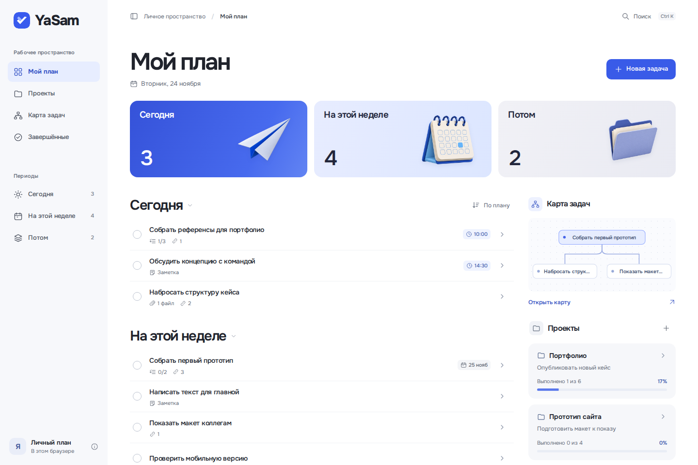

# YaSam

Личный таскер для трёх горизонтов планирования. На первом экране видны дела на сегодня, остаток недели и идеи на потом. Для большой цели можно создать проект, задать ожидаемый результат и следить за долей выполненных задач. Из тех же задач можно собрать карту связей.

[Открыть YaSam без регистрации](https://yasam.168.222.192.66.sslip.io/)



## Попробовать за минуту

1. Нажмите на название задачи и переименуйте её прямо в списке. Шеврон справа откроет полную карточку. В карточке можно изменить текст подзадачи и отметить шаг в чек-листе.
2. Откройте «Проекты» и создайте проект. В поле «Результат» запишите, что должно получиться. Добавьте в проект две задачи и отметьте одну выполненной. На карточке появится 50%.
3. Назначьте второй задаче сегодняшнюю дату и откройте «Сегодня». Из этого списка её можно отредактировать, прикрепить файл или вернуть в другой период, сняв дату.
4. Перейдите в «Карта задач». Создайте карту, выберите две задачи и нажмите «Связать». Передвиньте карточку и обновите страницу. Её положение сохранится.

[Редактор задачи](preview/editor.png) · [Мобильный экран](preview/mobile.png) · [Карта задач](preview/map.png) · [Исследование, JTBD и сравнение вариантов](RESEARCH.md)

## Запуск

Понадобится Node.js 20 или новее. Чтобы открыть приложение, выполните команду из корня репозитория.

```sh
npm start
```

Адрес по умолчанию — `http://127.0.0.1:4173`. Порт задаётся переменной `PORT`. Для статического хостинга достаточно содержимого `dist/`. В этой папке лежат исходные ES-модули, стили, шрифты и изображения. Сборка и установка пакетов для запуска приложения не требуются.

## Как работает план

- Миниатюры показывают число открытых дел в каждом периоде. Нажатие на миниатюру открывает период, а на заголовок в списке — сворачивает или раскрывает его задачи. На телефоне срок стоит под названием задачи.
- В разделе «Проекты» задайте название и желаемый результат. Внутри проекта можно добавить новое дело или выбрать существующее из плана. Поле «Проект» в карточке задачи позволяет перенести её в другой проект или оставить без проекта.
- Процент проекта равен доле завершённых задач среди всех его задач. Пустой проект показывает 0%. Удаление проекта оставляет дела в плане.
- В редакторе круглая галочка меняет статус черновика. «Сохранить» применяет его вместе с другими изменениями. Файл можно перетащить в блок «Файлы» или прикрепить через выбор на устройстве.

- Без точной даты период выбирает человек. Задачи со сроком до сегодняшнего дня включительно попадают в «Сегодня». Оставшиеся даты до воскресенья включительно относятся к «На этой неделе». Более поздние даты попадают в «Потом». Новый день определяется по календарю устройства.
- У задачи есть название, необязательные дата и время, чек-лист, заметка, вложения и связи. Решение о завершении всей задачи принимает человек.
- Карта хранит выбранные задачи и их координаты. Название, статус и связи принадлежат самой задаче. Удаление карточки из состава карты оставляет дело в плане. Удаление самого дела очищает его файлы, связи и вхождения во все карты.
- На холсте карточки перемещаются мышью, пальцем или стрелками клавиатуры. `Shift` со стрелкой увеличивает шаг. Доступны масштабирование и команда «Вместить карту».
- Поиск по названию, заметке, подзадаче и имени файла открывается из шапки или через `Ctrl K` / `⌘ K`.

## Данные

При первом открытии YaSam создаёт небольшой пример плана для портфолио. Задачи и файлы сохраняются в IndexedDB на текущем устройстве и принадлежат конкретному браузеру и адресу сайта. Очистка данных сайта удаляет план. Синхронизация между устройствами в эту версию не входит.

Запись задачи и вложений проходит в одной транзакции. Вкладки получают уведомление об изменении плана. Если старый черновик конфликтует с новой версией, YaSam сохраняет новую версию и показывает ошибку в открытом редакторе. Сервер раздаёт статические файлы, пользовательские вложения остаются в браузере.

## Проверки

```sh
npm run verify
```

Команда запускает проверки модели и синтаксиса. Для сквозных браузерных сценариев установите тестовую зависимость и Chromium.

```sh
npm ci
npx playwright-core install chromium
```

Оставьте `npm start` запущенным в первом терминале, во втором запустите проверку.

```sh
npm run test:browser
```

Браузерный прогон работает в изолированных профилях. Он проверяет проекты и их прогресс, переименование в списке, редактор, календарь, вложения, связи и карту. Отдельные сценарии открывают старую базу с файлом, сохраняют изменения из двух вкладок и проверяют меню на экране шириной 320 пикселей. Переменная `TEST_URL` задаёт адрес проверяемой версии.

## Структура

| Файл | Назначение |
| --- | --- |
| `dist/model.js` | Правила периодов, проекты, прогресс, задачи, связи и состав карт |
| `dist/store.js` | Транзакции IndexedDB и обмен изменениями между вкладками |
| `dist/app.js` | Навигация, список, поиск и обзор плана |
| `dist/editor.js` | Черновик задачи, подзадачи и файлы |
| `dist/map.js` | Холст, компоновка и взаимодействие с узлами |
| `dist/ui.js`, `dist/styles.css` | Общие элементы, типографика и адаптивная сетка |
| `server.mjs` | Локальный статический сервер |
| `tests/` | Проверки модели и пользовательских сценариев |

## Визуальные материалы

Шрифт Onest поставляется с лицензией [SIL Open Font License](dist/assets/OFL.txt). Три предметные иллюстрации сделаны встроенным генератором изображений для этого проекта. Общая постановка — изолированный предмет на прозрачном фоне, мягкий студийный свет, молочно-белая и кобальтовая палитра. Для «Сегодня» задан сложенный бумажный самолёт с синей внутренней гранью, для недели — настольный перекидной календарь, для «Потом» — приоткрытая папка с листами. Готовые файлы лежат в `dist/assets/today.png`, `week.png` и `later.png`.
